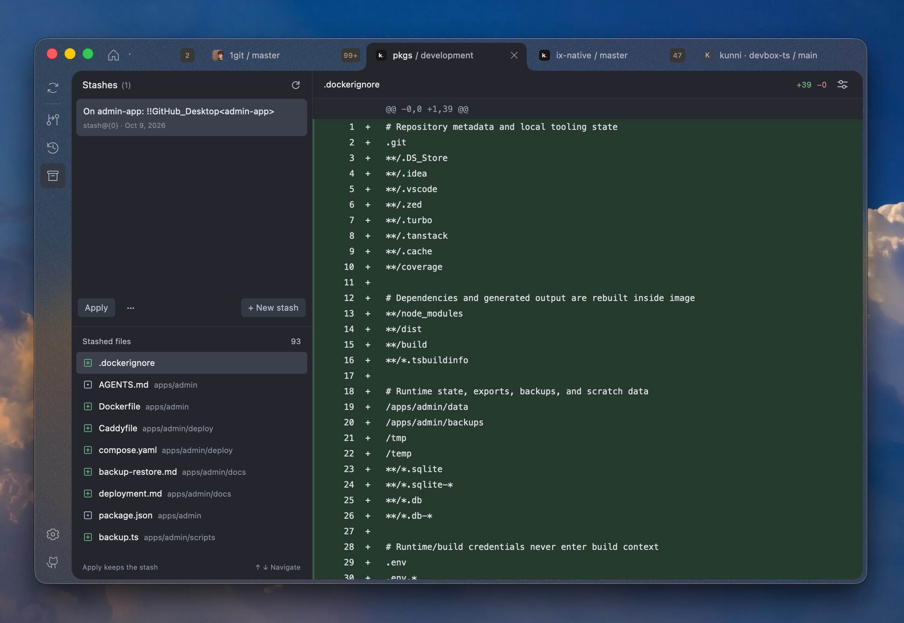

<div align="center">
  
  <p>A native Git workspace for macOS.</p>
  <p>Local repositories, SSH machines, worktrees, and AI commit messages in one calm workspace.</p>

  <p>
    <a href="https://git.1bye.dev">Website</a> ·
    <a href="https://git.1bye.dev/download">Download for macOS</a> ·
    <a href="https://github.com/1bye/1git/releases">Releases</a> ·
    <a href="CONTRIBUTING.md">Contributing</a>
  </p>

  <a href="LICENSE"></a>
  
  
</div>



## A workspace for everyday Git

- **Review and commit.** Inspect text and image diffs, choose files, and write commits.
- **Explore history.** Browse commits, branches, tags, stashes, and the commit graph.
- **Keep work organized.** Use tabs, spaces, and worktrees to move between projects.
- **Work over SSH.** Browse repositories on macOS and Linux machines through the same workspace.
- **Connect your accounts.** Work with GitHub and GitLab repositories and pull or merge requests.
- **Draft with AI.** Generate commit messages with OpenCode, ChatGPT, or your installed Claude Code and Codex CLI.
- **Make it yours.** Choose themes and repository colors, icons, and artwork.

Built with TypeScript, React 19, Bun, and [GPUIX](https://github.com/remorses/gpuix).
The desktop interface uses native rendering and macOS window materials.

ChatGPT offers **CLI** (the default, using Codex) and **Login** connection tiles.
Existing connections retain their selected method.

For CLI commit messages, install and sign in to Claude Code (`claude auth login`)
or Codex (`codex login`), then add it in **Settings → AI**. Choose a model from
the dropdown, or select **Use CLI default**. Both agents report their available
models and per-model effort options. **Effort** initially selects Medium when
supported, otherwise the model's reported default. **Provider default** inherits
the agent's settings, as does **Use CLI default**. Unknown capabilities never
produce guessed effort options. Direct API accounts use their live model list
with capability metadata from the bundled Pi catalog where available.
**Advanced** contains custom model
entry and an optional executable path for installations outside the usual search paths.
**Test agent** sends a synthetic diff to verify the connection using your CLI account.
1git reuses the CLI's authentication without copying its credentials. Generation
uses the checked files and selected lines, with tools and hooks restricted, and
only updates the commit draft. CLI requests currently support up to 64 KiB of
selected changes; larger selections can use an API connection.

Run `bun run --cwd apps/gpuix test:ai:process` for subprocess regression tests.
`bun run --cwd apps/gpuix test:ai:cli` explicitly tests both installed agents
against their real providers and uses their signed-in accounts. Optional
`GPUIX_CLAUDE_PATH`, `GPUIX_CODEX_PATH`, and `GPUIX_CODEX_MODEL` variables select
test executables or a Codex model without changing the CLI configuration.

## Download

**[Download the latest macOS beta →](https://git.1bye.dev/download)**

Requires **macOS 13 or later**, an **Apple Silicon Mac**, and **Git**. Extract the
ZIP and move `1git.app` to Applications. Bun, Rust, and Xcode are only needed to
build from source. Intel macOS and Linux machines can be used as SSH hosts; the
desktop download is currently Apple Silicon only.

If macOS blocks a trusted download, follow [Apple's Open Anyway instructions](https://support.apple.com/en-us/102445).
Default builds use local ad-hoc signing and are not Developer ID signed or
notarized. See the [FAQ](https://git.1bye.dev/faq/) for installation guidance.

The website's `/download` link follows the current signed update feed. Installed
release builds can check for updates through Sparkle. [Release instructions](docs/RELEASING.md)
explain versioned downloads and GitHub release notes.

## Build from source

The native app is developed on an Apple Silicon Mac. Install:

- [Bun](https://bun.sh), using the version in `package.json` (`1.4.2`).
- Git and full Xcode, selected with `xcode-select`.
- [Rust and rustup](https://rustup.rs). The pinned GPUIX sources select their Rust toolchain.

```sh
git clone https://github.com/1bye/1git.git
cd 1git
bun install --frozen-lockfile
bun run dev:app
```

Bun 1.4.2 is pinned for macOS packaging; 1.3.13 can produce compiled executables
that fail strict signature validation.

The first launch builds the workspace dependencies and patched native addon.
It downloads pinned GPUIX sources and can take several minutes. Later launches
reuse that build. See [native development and packaging](apps/gpuix/README.md)
for platform requirements and native diagnostics.

To build a local app bundle:

```sh
bun run package:macos
open apps/gpuix/build/macos/1git.app
```

Packaging and releases require no Apple account, certificate, or notarization.
Apple Silicon requires a local ad-hoc signature; packaging adds it automatically
without an identity or private key. Sparkle update archives retain their separate
Ed25519 signatures. Existing Keychain credentials may need access approval or
reconnection after changing signing mode.

The website can be developed independently:

```sh
bun run dev:web
bun run build:web
```

No Cloudflare account, signing key, or hosting token is required for ordinary
source builds, website previews, or portable tests.

## Development commands

| Command | Purpose |
| --- | --- |
| `bun run dev:app` | Start the native app and build its prerequisites |
| `bun run dev:web` | Start the Astro website |
| `bun run build` | Compile the apps and shared packages |
| `bun run check` | Run Oxlint and check Oxfmt formatting |
| `bun run fix` | Apply lint fixes and formatting |
| `bun run check-types` | Check app, package, and test types |
| `bun run test:portable` | Test packages, website, and release infrastructure without graphics access |
| `bun run test` | Run all default suites, including native UI tests |
| `bun run playground` | Create disposable repositories for trying Git workflows |
| `bun run package:macos` | Build a macOS app bundle and ZIP |

Native UI tests require macOS graphics access. Build the patched addon first with
`bun run --cwd apps/gpuix build:native`. CI runs lint, formatting, types, builds,
and the portable suites; native UI and signing checks run on a configured Mac.

The playground uses temporary repositories and a local remote; it needs no GitHub
account or network. Open the printed `02-compare` path in the app and follow the
generated `START-HERE.md` for commits, branches, stashes, worktrees, and conflicts.
Each run preserves earlier playgrounds. Close their tabs and delete the generated
folder when finished; keep real work elsewhere.

## Repository layout

```text
apps/
  gpuix/                Native macOS app, native patches, SSH helper, packaging
  web/                  Astro website at git.1bye.dev
  releases/             Cloudflare downloads and signed update publishing
packages/
  analytics/            Anonymous analytics policy and transport
  config/               Shared TypeScript configuration
  design-tokens/        Shared visual scales and native theme values
  git/                  Structured Git operations
  gpuix-stylesheet/     Typed native styles
  gpuix-ui/             Native React components and component playground
  hosting/              GitHub and GitLab APIs
```

The workspace packages remain `private` to prevent accidental npm publication.
Source builds and contributions are covered by the repository's MIT license.

## Privacy and security

Git credentials use configured credential helpers and SSH agents. Saved app
account secrets use macOS Keychain. Remote Git operations use credentials on the
SSH host. AI features send selected context to the provider you configure.

Production app and website builds collect a limited set of anonymous usage events
by default. Disable them in **Settings → Privacy** or the website's **Anonymous
analytics** control. Development and preview builds stay offline. See the
[analytics policy](packages/analytics/README.md) for the exact events and limits.

Please follow the [security policy](SECURITY.md) for vulnerabilities, and use
[GitHub Issues](https://github.com/1bye/1git/issues) for bugs and feature requests.

## Contributing and license

Contributions are welcome. Start with [CONTRIBUTING.md](CONTRIBUTING.md) for setup,
checks, and pull requests. Maintainers can use the [public launch checklist](docs/PUBLISHING.md)
and [release guide](docs/RELEASING.md).

1git is available under the [MIT license](LICENSE). Bundled libraries, fonts,
icons, and other third-party assets retain their own licenses; see
[third-party notices](THIRD_PARTY_NOTICES.md).
