<div align="center">
  
  <p>A native Git workspace for macOS.</p>

  <p>
    <a href="https://git.1bye.dev">Website</a> ·
    <a href="https://git.1bye.dev/download">Download</a> ·
    <a href="ROADMAP.md">Roadmap</a> ·
    <a href="CONTRIBUTING.md">Contributing</a>
  </p>

  <a href="LICENSE"></a>
  
  
</div>

## Features

- **Review and commit** — text and image diffs, file and line selection.
- **Explore history** — commits, branches, tags, stashes, and the commit graph.
- **Stay organized** — tabs, spaces, and worktrees.
- **Work over SSH** — open repositories on remote macOS and Linux machines.
- **GitHub and GitLab** — connect accounts and work with pull or merge requests.
- **AI commit messages** — OpenCode, ChatGPT, Claude Code, Codex, or any API. [Setup →](docs/AI.md)
- **Make it yours** — themes, repository colors, icons, and artwork.

## Roadmap

See [ROADMAP.md](ROADMAP.md) for what's shipped, what's next, and what's planned.

## Download

**[Download the latest macOS beta →](https://git.1bye.dev/download)**

Requires macOS 13+, an Apple Silicon Mac, and Git. Builds are not notarized yet;
if macOS blocks the app, see [Apple's Open Anyway instructions](https://support.apple.com/en-us/102445)
or the [FAQ](https://git.1bye.dev/faq/).

## Build from source

Requires [Bun](https://bun.sh) 1.4.2, full Xcode, and [Rust](https://rustup.rs).

```sh
git clone https://github.com/1bye/1git.git
cd 1git
bun install --frozen-lockfile
bun run dev:app
```

The first launch builds the native addon and can take a few minutes. See
[CONTRIBUTING.md](CONTRIBUTING.md) for checks and tests, and the
[native app guide](apps/gpuix/README.md) for packaging and diagnostics.

## Privacy

Credentials stay in your Git helpers, SSH agents, and macOS Keychain. AI features
send only the selected changes to the provider you choose. Anonymous usage events
can be turned off in **Settings → Privacy** ([details](packages/analytics/README.md)).
Report vulnerabilities via the [security policy](SECURITY.md).

## License

[MIT](LICENSE). Third-party assets keep their own licenses; see
[third-party notices](THIRD_PARTY_NOTICES.md).
