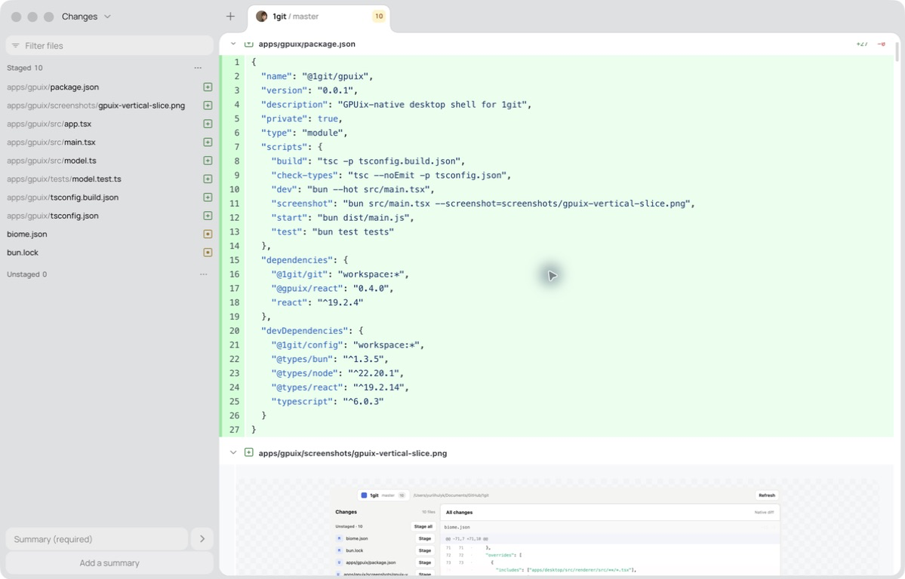
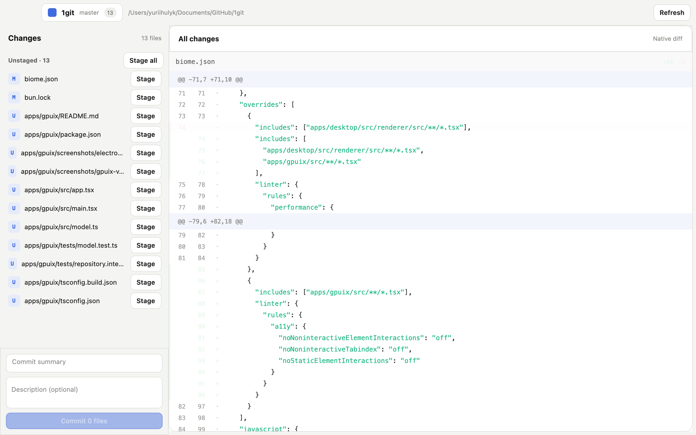

# 1git GPUix vertical slice

This app is a parallel, native GPUix implementation of the current 1git
changes workspace. It uses `@1git/git` directly and passes unified Git patches
to GPUix's native `<diff>` element. It does not use an SDF, canvas, mask, or
shared renderer layer.

Implemented in this slice:

- open one repository from a CLI path;
- select a changed file or view all changes;
- stage and unstage one file or every file;
- commit staged files with a summary and optional description;
- refresh repository state;
- render and capture the native window through GPUix's Metal test renderer.

Run it from the repository root:

```sh
bun run --cwd apps/gpuix dev -- /path/to/repository
```

Capture a deterministic native screenshot of this repository:

```sh
bun run --cwd apps/gpuix screenshot
```

## Visual baseline

| Current Electron app | GPUix vertical slice |
| --- | --- |
|  |  |

History, stashes, repository menus, the command lens, OS integrations, and
packaging remain intentionally outside this first vertical slice.
